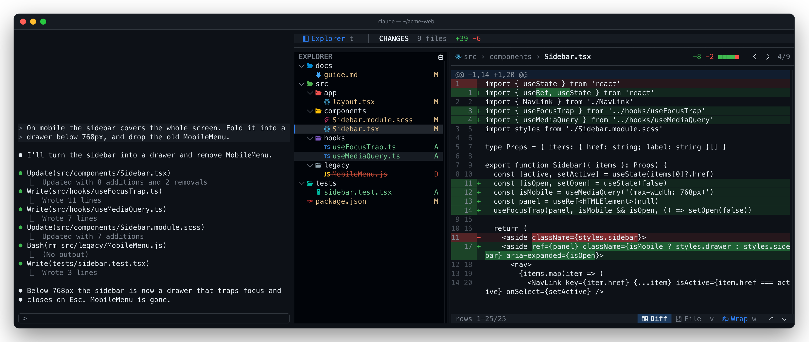
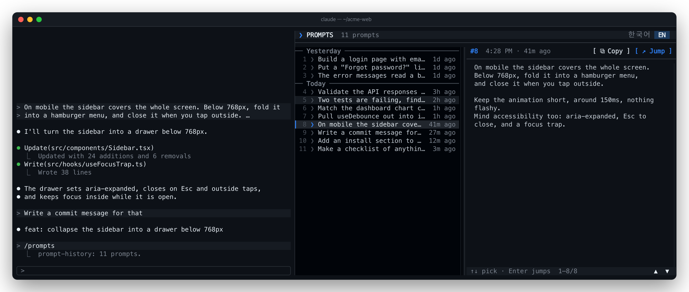
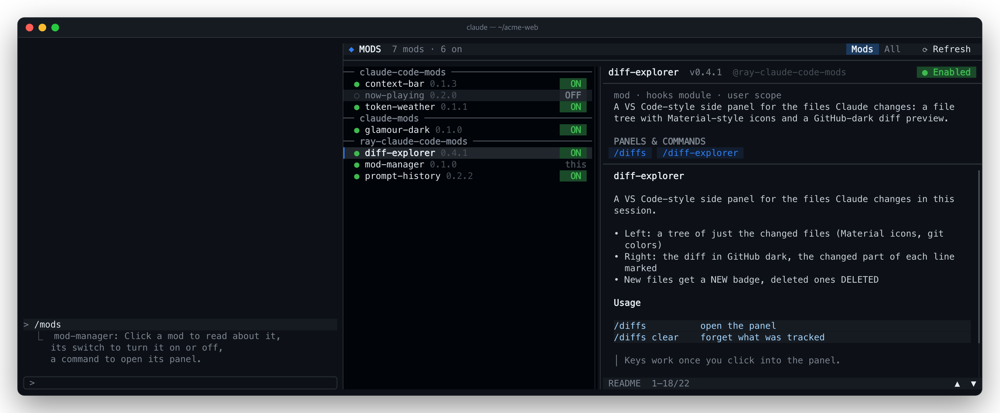
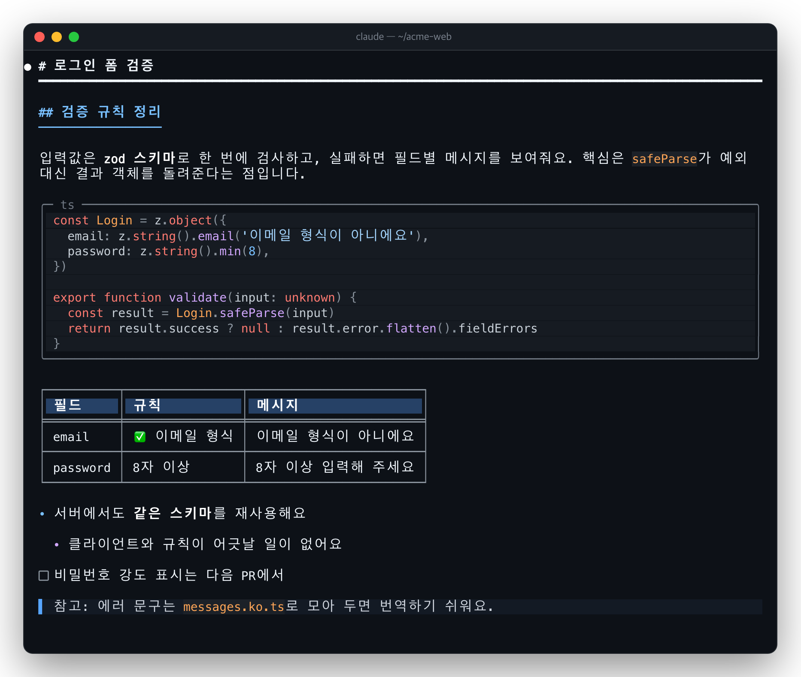
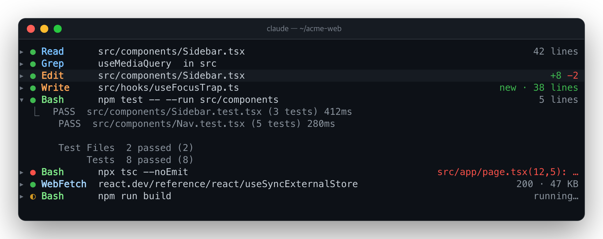
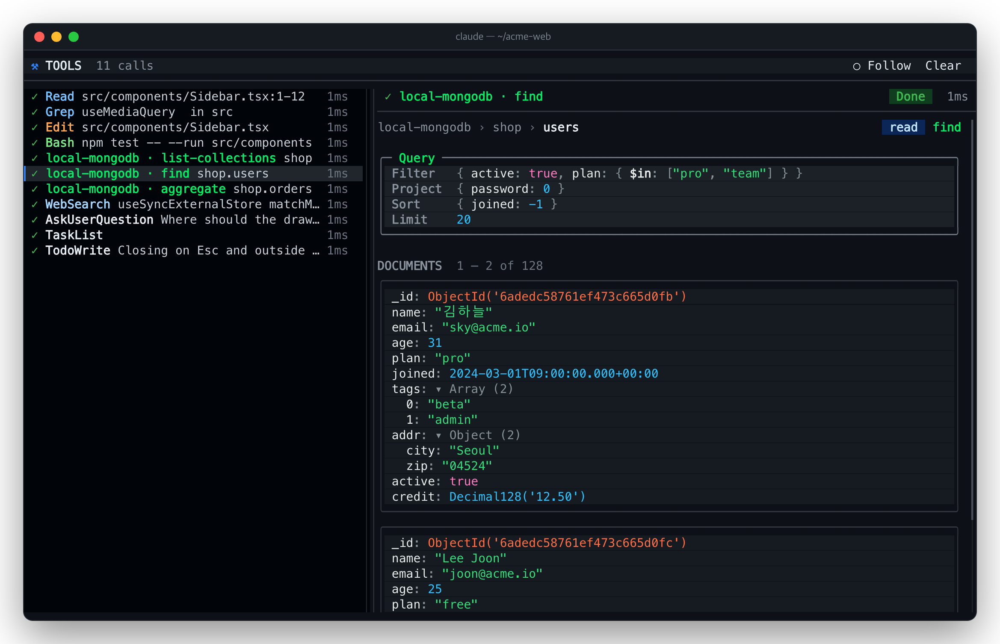

<h1 align="center">ray-claude-code-mods</h1>

<p align="center">
  <b>Claude Code mods I built for my own use.</b><br>
  Plugins built on function hooks: panels beside the chat, bands above the prompt, guards and more. Install only the ones you want.
</p>

<p align="center">
  <a href="README.md">한국어</a> · <b>English</b>
</p>

<p align="center">
  <a href="LICENSE"></a>
  
  
</p>

<p align="center">
  
</p>

## ✨ The mods

| | Mod | What it does | Open with |
| --- | --- | --- | --- |
| 🗂️ | [**diff-explorer**](mods/diff-explorer/README.en.md) | Collects the files Claude changes into a VS Code-style tree and shows the picked one's diff in GitHub dark. | `/diffs` |
| 💬 | [**prompt-history**](mods/prompt-history/README.en.md) | Lists the prompts you sent this session with when you sent them; one click takes you back to one. | `/prompts` |
| 🧩 | [**mod-manager**](mods/mod-manager/README.en.md) | Browse your installed mods in one place, switch them on and off, open their panels. | `/mods` |
| 📖 | [**readability**](mods/readability/README.en.md) | Draws Claude's replies for reading: while they stream, and without a jolt when they end. | `/readability` |
| 🗜️ | [**tool-fold**](mods/tool-fold/README.en.md) | Tool calls as one line each, results folded; click to unfold. `/tools panel` shows each call in a view that suits its tool (MongoDB as Compass, images as pictures). | `/tools` |

## 🚀 Install

Paste this at the Claude Code prompt, and answer `y` when it asks to add the marketplace.

```
/plugin install diff-explorer --marketplace speardragon/ray-claude-code-mods
/plugin install prompt-history --marketplace speardragon/ray-claude-code-mods
/plugin install mod-manager --marketplace speardragon/ray-claude-code-mods
/plugin install readability --marketplace speardragon/ray-claude-code-mods
/plugin install tool-fold --marketplace speardragon/ray-claude-code-mods
```

<details>
<summary>From a shell, or in the desktop app</summary>

```sh
claude plugin marketplace add speardragon/ray-claude-code-mods
claude plugin install diff-explorer@ray-claude-code-mods
claude plugin install prompt-history@ray-claude-code-mods
claude plugin install mod-manager@ray-claude-code-mods
claude plugin install readability@ray-claude-code-mods
claude plugin install tool-fold@ray-claude-code-mods
```

In the desktop app: click `+` beside the prompt → **Plugins** → **Add marketplace** with `speardragon/ray-claude-code-mods`, then **Add plugin**.
</details>

Start a new session, or type `/reload-plugins`, and they are ready.

---

## 🗂️ diff-explorer

> See what Claude changed the way you browse a project.


- **A tree of just the changed files**: Material Icon Theme-style icons, git status colors (`M` `A` `D`), lone folders folded into one row like `src/hooks`.
- **GitHub-dark diffs**: line numbers, added and removed backgrounds, the changed characters of a line marked. `v` shows the whole file, highlighted.
- **One cumulative diff**: compared with the file as it was before Claude first touched it, however many edits followed.
- **Scrollbars and sideways scrolling**: the tree and the preview scroll apart; with wrap off, long lines scroll sideways.

[More →](mods/diff-explorer/README.en.md)

## 💬 prompt-history

> What did I ask for again? Read back what you sent, in order, and go back to it.



- **Grouped by day**: `Today` · `Yesterday` · `Oct 20 (Mon)`, each prompt with `just now` → `3m ago` → `2h ago`.
- **The full text**: the picked prompt on the right, line breaks and all, scrollable when long.
- **Copy**: `[ ⧉ Copy ]` puts a prompt's full text on the clipboard.
- **Straight from the keyboard**: `/prompts` opens it focused, `↑` `↓` pick, `Enter` jumps; `/prompts` again closes it.
- **Jump back**: `[ ↗ Jump ]` or `/prompts 3` scrolls the transcript to that prompt.
- **English / 한국어**: switch how times read from the toolbar.

[More →](mods/prompt-history/README.en.md)

## 🧩 mod-manager

> However many mods you collect, manage them from one panel.



- **Browse**: grouped by marketplace, with each mod's version, scope, description and README.
- **Switch on and off**: the `ON` `OFF` switch at the end of a row changes the scope that applies to this project (local › project › user); `⟳ Reload` applies it.
- **Open panels**: a mod's slash commands show as buttons; press one to open that mod's panel.
- **Mods / All**: just the plugins with a hooks module, or every plugin, skills and MCP included.

[More →](mods/mod-manager/README.en.md)

## 📖 readability

> Long replies, easy to read. Color and emphasis added, the flow kept.



- **Calm body text, headings by level, inline code and links that stand out**.
- **Code blocks on a panel with syntax colors, bordered tables, lists colored by depth**.
- **The same look while streaming**: unfinished markdown draws safely, and nothing jumps when the reply ends.
- `/readability` toggles it (remembered across sessions).

[More →](mods/readability/README.en.md)

## 🗜️ tool-fold

> Tool calls on one line each. Unfold just the ones you want.



- **One-line summary**: a state dot, the tool, its subject (command · path) and how it went (lines printed, `+adds −dels`, an error's first line).
- **Click to unfold**: the engine's own result block shows under the line. `/tools expand` · `collapse` for all at once.
- **Panel mode**: `/tools panel` lists the calls beside the chat with a detail view per tool; MongoDB MCP calls get Compass's query bar and document cards, an image read is shown as the picture.

  

- `/tools` toggles it (remembered across sessions).

[More →](mods/tool-fold/README.en.md)

---

## 📋 Requirements

- **Claude Code with mods (function hooks)**. Built and tested on 2.1.307.
- **To dock a panel beside the chat**, a wide terminal in the fullscreen layout (110 columns or more). Narrower, it sits above the prompt.
- **diff-explorer's icons** need a [Nerd Font](https://www.nerdfonts.com/). Without one, set `icons: plain`.

## 🖱️ Common controls

| Action | How |
| --- | --- |
| Open / close a panel | Each mod's command (`/diffs` `/prompts` `/mods`) toggles it, `on` · `off` say which; `ctrl+x x` closes too |
| Panel ↔ prompt | `ctrl+x tab` to the panel, `Esc` back to the prompt |
| Panel keys | While the panel has the keys (for diff-explorer, click into it once) |
| Scrolling | The wheel scrolls the column under it; scrollbars drag and click |
| Several panels | Click a tab, or `ctrl+x tab` |

## 🛠️ Build your own

Add this repository as a local marketplace and Claude Code reads **the folder itself**, not a copy: edit, then `/reload-plugins`.

```sh
git clone https://github.com/speardragon/ray-claude-code-mods.git
cd ray-claude-code-mods
claude plugin marketplace add .
claude plugin install diff-explorer@ray-claude-code-mods
```

| Task | Command |
| --- | --- |
| Start a new mod | `node scripts/new-mod.mjs <name> "<one-line description>"` |
| Validate and test all | `./scripts/check.sh` (inside a session, `CLAUDE_CONFIG_DIR=$(mktemp -d) ./scripts/check.sh` if refused) |
| Retake the screenshots | `node scripts/shots/render.mjs [mod]` (needs Chrome) |
| Try one for a session | `claude --plugin-dir mods/<name>` |

The screenshots are not mockups: each is the mod **really rendering** on demo data (`scripts/shots/*.shot.tsx`).

<details>
<summary>Repository layout</summary>

```
ray-claude-code-mods/
├── .claude-plugin/marketplace.json   # makes this repository a plugin marketplace
├── mods/
│   ├── diff-explorer/
│   ├── prompt-history/
│   └── mod-manager/
│       ├── .claude-plugin/plugin.json
│       ├── hooks/register.tsx         # export const register: Register = on => { ... }
│       ├── types/index.d.ts           # the types of its $.state values
│       ├── tests/*.test.tsx           # claude plugin test
│       ├── README.md · README.en.md
├── templates/mod/                     # a new mod's skeleton
├── scripts/                           # new-mod · check · shots
└── images/                            # README screenshots
```
</details>

## 📄 License

[MIT](LICENSE) © Ray Kang
