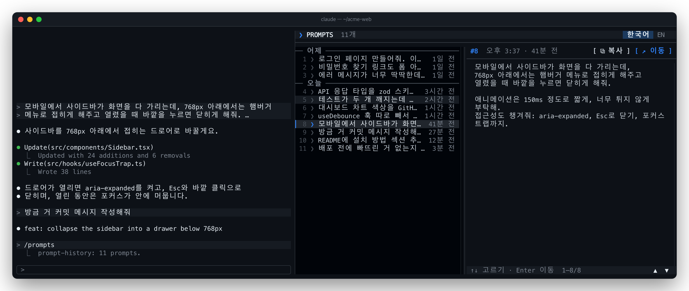
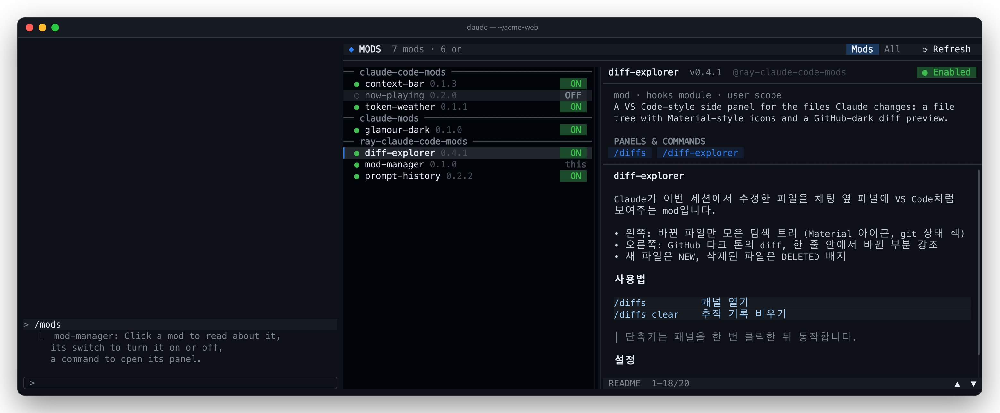

<h1 align="center">ray-claude-code-mods</h1>

<p align="center">
  <b>내가 쓰려고 만든 Claude Code mods 모음.</b><br>
  function hooks 기반 플러그인: 채팅 옆 패널, 프롬프트 위 밴드, 가드 등. 원하는 것만 골라 설치하세요.
</p>

<p align="center">
  <b>한국어</b> · <a href="README.en.md">English</a>
</p>

<p align="center">
  <a href="LICENSE"></a>
  
  
</p>

<p align="center">
  
</p>

## ✨ 들어 있는 mod

| | Mod | 하는 일 | 여는 명령 |
| --- | --- | --- | --- |
| 🗂️ | [**diff-explorer**](mods/diff-explorer) | Claude가 수정한 파일을 VS Code처럼 트리로 모으고, 고른 파일의 diff를 GitHub 다크 톤으로 보여줍니다. | `/diffs` |
| 💬 | [**prompt-history**](mods/prompt-history) | 이번 세션에 보낸 프롬프트를 시간과 함께 모아 보고, 클릭 한 번으로 그 위치로 돌아갑니다. | `/prompts` |
| 🧩 | [**mod-manager**](mods/mod-manager) | 설치한 mod를 한 곳에서 둘러보고, 켜고 끄고, 각 mod의 패널을 바로 엽니다. | `/mods` |
| 📖 | [**readability**](mods/readability) | Claude의 응답을 읽기 편하게 다시 그립니다. 스트리밍 중에도, 끝날 때 레이아웃이 튀지 않게. | `/readability` |

## 🚀 설치

Claude Code 프롬프트에 붙여 넣으세요. 마켓플레이스를 추가할지 물으면 `y`를 누르면 됩니다.

```
/plugin install diff-explorer --marketplace speardragon/ray-claude-code-mods
/plugin install prompt-history --marketplace speardragon/ray-claude-code-mods
/plugin install mod-manager --marketplace speardragon/ray-claude-code-mods
/plugin install readability --marketplace speardragon/ray-claude-code-mods
```

<details>
<summary>셸이나 데스크톱 앱에서 설치하기</summary>

```sh
claude plugin marketplace add speardragon/ray-claude-code-mods
claude plugin install diff-explorer@ray-claude-code-mods
claude plugin install prompt-history@ray-claude-code-mods
claude plugin install mod-manager@ray-claude-code-mods
claude plugin install readability@ray-claude-code-mods
```

데스크톱 앱에서는 프롬프트 옆 `+` → **Plugins** → **Add marketplace**에 `speardragon/ray-claude-code-mods`를 넣고, **Add plugin**으로 고르세요.
</details>

설치한 뒤 새 세션을 열거나 `/reload-plugins`를 입력하면 바로 쓸 수 있어요.

---

## 🗂️ diff-explorer

> Claude가 무엇을 바꿨는지, 파일 탐색기처럼 둘러보세요.


- **바뀐 파일만 모은 트리**: Material Icon Theme 스타일 아이콘, git 상태 색(`M` `A` `D`), 하나뿐인 하위 폴더는 `src/hooks`처럼 한 줄로.
- **GitHub 다크 diff**: 줄 번호, 추가·삭제 배경, 한 줄 안에서 바뀐 글자만 진하게. `v`로 파일 전체 보기(구문 강조).
- **누적 기준**: Claude가 그 파일을 처음 건드리기 직전과 비교하므로, 여러 번 고쳐도 한 번에 보입니다.
- **스크롤바와 가로 스크롤**: 트리·미리보기가 따로 스크롤되고, 줄바꿈을 끄면 가로로도 이동.

[자세히 보기 →](mods/diff-explorer)

## 💬 prompt-history

> 내가 뭘 시켰더라? 보낸 프롬프트를 시간 순서로 다시 보고, 그때로 돌아가세요.



- **날짜별 목록**: `오늘` · `어제` · `10월 20일 (월)`로 묶고, `방금 전` → `3분 전` → `2시간 전`처럼 상대 시간으로.
- **전문 미리보기**: 고른 프롬프트를 오른쪽에 줄바꿈까지 그대로. 길면 스크롤.
- **복사**: `[ ⧉ 복사 ]`로 프롬프트 전문을 클립보드에.
- **키보드로 바로**: `/prompts`로 켜면 패널에 포커스가 가서 `↑` `↓`로 고르고 `Enter`로 이동. 한 번 더 `/prompts` 하면 꺼져요.
- **그 위치로 이동**: `[ ↗ 이동 ]` 또는 `/prompts 3` 한 번이면 트랜스크립트가 그 프롬프트로.
- **한국어 / English**: 시간 표기를 툴바에서 바로 전환.

[자세히 보기 →](mods/prompt-history)

## 🧩 mod-manager

> 설치한 mod가 늘어나도, 관리는 한 패널에서.



- **둘러보기**: 마켓플레이스별 목록과 각 mod의 버전, 설치 범위, 설명, README.
- **켜기 / 끄기**: 줄 끝 `ON` `OFF` 스위치. 이 프로젝트에 실제로 적용되는 범위(local › project › user)를 바꾸고, `⟳ Reload`로 바로 적용.
- **패널 열기**: mod가 등록한 명령이 버튼으로 나와서, 누르면 그 mod의 패널이 열립니다.
- **Mods / All**: hooks 모듈이 있는 mod만, 또는 스킬·MCP 플러그인까지 전부.

[자세히 보기 →](mods/mod-manager)

## 📖 readability

> 긴 응답도 편하게. 색과 강조는 더하고, 줄 흐름은 그대로.


- **차분한 본문, 단계별 제목, 눈에 띄는 인라인 코드와 링크**.
- **코드 블록 패널과 구문 강조, 테두리 있는 표, 색이 다른 중첩 목록**.
- **스트리밍 중에도 같은 모습**: 미완성 마크다운도 안전하게 그리고, 끝나는 순간 줄이 튀지 않아요.
- `/readability`로 켜고 끄기(다음 세션에도 유지).

[자세히 보기 →](mods/readability)

---

## 📋 필요한 것

- **Claude Code의 mod(function hooks) 지원**. 2.1.307에서 개발하고 테스트했습니다.
- **패널을 옆에 붙이려면** 전체 화면 레이아웃의 터미널이 넓어야 해요(110칸 이상). 좁으면 프롬프트 위에 붙습니다.
- **diff-explorer 아이콘**은 [Nerd Font](https://www.nerdfonts.com/)가 있어야 제대로 보여요. 없으면 설정에서 `icons: plain`으로 바꾸세요.

## 🖱️ 공통 조작

| 동작 | 방법 |
| --- | --- |
| 패널 켜기 / 끄기 | 각 mod의 명령(`/diffs` `/prompts` `/mods`)이 토글, `on` · `off`로 명시도 가능. 닫기는 `ctrl+x x`도 됨 |
| 패널 ↔ 입력창 | `ctrl+x tab`으로 패널로, `Esc`로 입력창으로 |
| 패널 단축키 | 패널에 포커스가 있을 때 (diff-explorer는 패널 안을 한 번 클릭한 뒤) |
| 스크롤 | 휠은 커서가 올라간 컬럼만, 스크롤바는 드래그·클릭 |
| 여러 패널 | 위쪽 탭을 클릭하거나 `ctrl+x tab` |

## 🛠️ 직접 만들고 고치기

이 레포를 그대로 로컬 마켓플레이스로 등록하면, 설치본이 아니라 **폴더를 직접 읽어서** 고친 즉시 `/reload-plugins`로 반영됩니다.

```sh
git clone https://github.com/speardragon/ray-claude-code-mods.git
cd ray-claude-code-mods
claude plugin marketplace add .
claude plugin install diff-explorer@ray-claude-code-mods
```

| 할 일 | 명령 |
| --- | --- |
| 새 mod 만들기 | `node scripts/new-mod.mjs <name> "<한 줄 설명>"` |
| 전체 검증 + 테스트 | `./scripts/check.sh` (세션 안에서 막히면 `CLAUDE_CONFIG_DIR=$(mktemp -d) ./scripts/check.sh`) |
| 스크린샷 다시 찍기 | `node scripts/shots/render.mjs [mod]` (Chrome 필요) |
| 한 세션에서만 띄워보기 | `claude --plugin-dir mods/<name>` |

스크린샷은 손으로 그린 게 아니라 각 mod를 데모 데이터로 **실제로 렌더링한 결과**입니다(`scripts/shots/*.shot.tsx`).

<details>
<summary>레포 구조</summary>

```
ray-claude-code-mods/
├── .claude-plugin/marketplace.json   # 이 레포 = 플러그인 마켓플레이스
├── mods/
│   ├── diff-explorer/
│   ├── prompt-history/
│   └── mod-manager/
│       ├── .claude-plugin/plugin.json
│       ├── hooks/register.tsx         # export const register: Register = on => { ... }
│       ├── types/index.d.ts           # $.state 값의 타입
│       ├── tests/*.test.tsx           # claude plugin test
│       ├── README.md · README.en.md
├── templates/mod/                     # 새 mod 뼈대
├── scripts/                           # new-mod · check · shots
└── images/                            # README 스크린샷
```
</details>

## 📄 라이선스

[MIT](LICENSE) © Ray Kang
