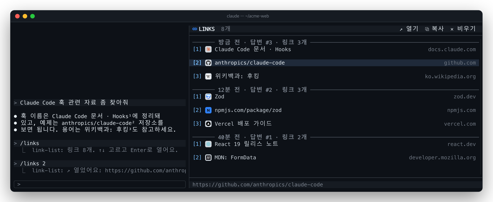

# 🔗 link-list

[한국어](README.md) · **English**

Every link Claude writes in a reply, collected in a pane beside the chat: grouped by reply, each with its site's favicon,
opened in the browser with a click or `Enter`.



## Features

- **By reply**: newest reply on top. Under a `just now · reply #3 · 3 links` rule, each link's number, favicon, words and
  host.
- **The numbers readability writes**: [readability](../readability) puts `¹²³` after the links in a reply, and the pane
  shows the same numbers as `[1]` `[2]`: the `²` you read is the pane's `[2]`. `/links 2` opens link 2 of the latest reply.
- **Favicons**: the site's `/favicon.ico`, else the icon its home page names, laid on a rounded square tile (light gray)
  like an app's icon, so dark icons show too. A site with no icon to fetch gets its host's letter on a colored tile; a
  terminal that cannot draw pictures shows the same letter as a badge.
- **Aligned columns**: number, favicon, words and host start at the same cell on every row (Hangul counted two cells).
  Panes narrower than 56 columns drop the host column.
- **Open · copy**: click a row or press `Enter` to open it (`open` on macOS, `xdg-open` on Linux); `c` or `⧉ Copy` copies
  the URL.
- **Earlier replies too**: on load it reads the links of the replies so far from the session transcript, then adds each
  reply as it ends. A URL repeated in a reply is listed once; URLs in code blocks and inline code are left out. `/clear`
  empties it.

## Install

```
/plugin install link-list --marketplace speardragon/ray-claude-code-mods
```

Install readability too for the numbers in the replies.

## Usage

| Input | Does |
| --- | --- |
| `/links` | Toggle the pane. Opening it focuses it, so `↑` `↓` pick right away |
| `/links on` · `/links off` | Open · close the pane |
| `/links 2` | Open link 2 of the latest reply that has links |
| `/links clear` | Empty the list |
| Click a row | Open that link |
| `↑` `↓` · `j` `k` | (pane focused) Pick a link; `PageUp` `PageDown` several, `Home` `End` the first / last |
| `Enter` · `↗ Open` | Open the picked link |
| `c` · `⧉ Copy` | Copy the picked link's URL |
| `✕ Clear` | Empty the list |

The command runs at once even while Claude is replying.

## Settings

| Key | Default | What it does |
| --- | --- | --- |
| `locale` | `ko` | The rules' times and words: `ko` (`3분 전 · 답변 #2`) or `en` (`3m ago · reply #2`) |

## Good to know

- **Favicons are fetched once the pane has been opened.** A session that never opens it makes no requests. Only the
  linked site is asked, once per session; the pictures stay in `$TMPDIR/link-list/`.
- **Pictures show only where the terminal draws them** (kitty graphics: kitty, Ghostty, WezTerm, iTerm2 3.5+…). For a
  terminal Claude Code does not know, set `CLAUDE_CODE_FORCE_TERMINAL_IMAGES=1`. The desktop app shows badges.
- Icons are read with macOS `sips` (else ImageMagick) and tiled with macOS `osascript` (AppKit). Elsewhere the icon sits
  on a light square without the tile. Sites behind Cloudflare and the like keep a letter tile.
- The toolbar icon needs a [Nerd Font](https://www.nerdfonts.com/).
