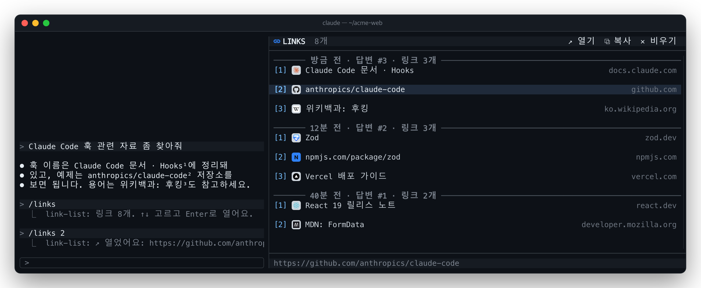

# 🔗 link-list

**한국어** · [English](README.en.md)

Claude가 답변에 쓴 링크를 전부 모아 채팅 옆 패널에 보여줍니다. 사이트 파비콘과 함께 답변별로 묶어 두고, 클릭 한 번이나
`Enter`로 브라우저에서 엽니다.



## 기능

- **답변별 목록**: 최신 답변이 맨 위. `방금 전 · 답변 #3 · 링크 3개` 구분선 아래 링크마다 번호, 파비콘, 글, 도메인.
- **readability와 같은 번호**: [readability](../readability)가 답변 본문의 링크 뒤에 `¹²³`을 붙이고, 패널은 같은 번호를
  `[1]` `[2]`로 보여줘요. 본문에서 본 `²`가 패널의 `[2]`입니다. `/links 2`는 최근 답변의 2번 링크를 바로 엽니다.
- **파비콘**: 사이트의 `/favicon.ico`, 없으면 홈페이지가 지정한 아이콘을 받아 앱 아이콘처럼 둥근 정사각형 타일(밝은
  회색 바탕)에 올려 그립니다. 어두운 아이콘도 잘 보여요. 아이콘을 못 받은 사이트는 도메인 첫 글자를 색 타일에 그리고,
  그림을 그릴 수 없는 터미널은 같은 글자 배지로 보여줘요.
- **정렬된 열**: 번호, 파비콘, 글, 도메인이 모든 줄에서 같은 칸에 맞춰집니다(한글은 2칸으로 계산). 패널이 56칸보다
  좁으면 도메인 열은 빠져요.
- **열기 · 복사**: 줄을 클릭하거나 `Enter`로 열고(macOS `open`, 리눅스 `xdg-open`), `c`나 `⧉ 복사`로 URL 복사.
- **이전 답변까지**: 켜질 때 세션 트랜스크립트에서 그동안의 답변 링크를 읽어 오고, 이후엔 답변이 끝날 때마다 추가.
  같은 답변에서 같은 URL은 한 번만. 코드 블록과 인라인 코드 안의 URL은 빠집니다. `/clear` 하면 비워져요.

## 설치

```
/plugin install link-list --marketplace speardragon/ray-claude-code-mods
```

본문 번호까지 보려면 readability도 함께 설치하세요.

## 사용법

| 입력 | 동작 |
| --- | --- |
| `/links` | 패널 켜기 / 끄기 (토글). 켤 때 패널에 포커스가 가서 바로 `↑` `↓`로 고를 수 있어요 |
| `/links on` · `/links off` | 패널 켜기 · 끄기 |
| `/links 2` | 링크가 있는 최근 답변의 2번 링크 열기 |
| `/links clear` | 목록 비우기 |
| 줄 클릭 | 그 링크 열기 |
| `↑` `↓` · `j` `k` | (패널에 포커스가 있을 때) 링크 고르기. `PageUp` `PageDown`은 여러 개씩, `Home` `End`는 처음 / 끝 |
| `Enter` · `↗ 열기` | 고른 링크 열기 |
| `c` · `⧉ 복사` | 고른 링크의 URL 복사 |
| `✕ 비우기` | 목록 비우기 |

명령은 Claude가 답변하는 도중에 쳐도 바로 실행됩니다.

## 설정

| 키 | 기본값 | 설명 |
| --- | --- | --- |
| `locale` | `ko` | 구분선의 시간과 문구: `ko`(`3분 전 · 답변 #2`) 또는 `en`(`3m ago · reply #2`) |

## 알아두면 좋은 것

- **파비콘은 패널을 처음 열 때부터 받습니다.** 패널을 한 번도 열지 않은 세션은 어디에도 요청하지 않아요. 요청은 링크된
  사이트에만 하고, 사이트마다 세션에 한 번입니다. 받은 그림은 `$TMPDIR/link-list/`에 남아요.
- **그림은 터미널이 그림을 그릴 수 있을 때만 보입니다**(kitty 그래픽: kitty, Ghostty, WezTerm, iTerm2 3.5+ 등).
  Claude Code가 모르는 터미널이면 `CLAUDE_CODE_FORCE_TERMINAL_IMAGES=1`을 설정하세요. 데스크톱 앱은 배지로 보여요.
- 아이콘 변환에는 macOS의 `sips`(없으면 ImageMagick), 둥근 타일에는 macOS의 `osascript`(AppKit)를 씁니다. 다른
  OS에서는 타일 없이 밝은 정사각형 위에 아이콘을 그려요. Cloudflare 등이 막는 사이트는 글자 타일로 남아요.
- 툴바 아이콘은 [Nerd Font](https://www.nerdfonts.com/)가 있어야 제대로 보여요.
