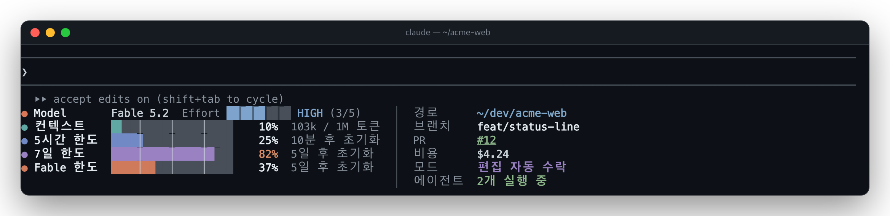

# 📊 status-line

[한국어](README.md) · **English**

A status line under the prompt, laid out like a table: the model and meters for the context window and the plan's
limits on the left; the path, branch, pull request, cost, permission mode and agents at work on the right.



## What it shows

```
  ⏵⏵ accept edits on (shift+tab to cycle)    ← Claude Code's own hint line (kept, always on top)
● Model       Fable 5.2  Effort ██▎█▎█▎█▎█ HIGH (3/5)     │  경로      ~/dev/acme-web
● 컨텍스트    █▋██│████│████│████    10%  103k / 1M 토큰  │  브랜치    feat/status-line
● 5시간 한도  ████│████│████│████    25%  10분 후 초기화  │  PR        #12
● 7일 한도    ████│████│████│█▏██    82%  5일 후 초기화   │  비용      $4.24
● Fable 한도  ████│█▉██│████│████    37%  5일 후 초기화   │  모드      편집 자동 수락
                                                          │  에이전트  2개 실행 중
```

Meters on the left, the state of things on the right. The labels and details are in Korean.

| Side | Item | What it is |
| --- | --- | --- |
| left | Model, Effort | The model's name and its effort on five steps (`██▎█▎█▎█▎█ HIGH (3/5)`, five squares) |
| left | 컨텍스트 (context) | The context window's fill, and `tokens used / window size` |
| left | 5시간 한도, 7일 한도 (five-hour, weekly) | The limits' use and the time to their reset (`2시간 13분 후 초기화`) |
| left | Fable 한도 | The Fable-only weekly limit and the time to its reset, whatever the model |
| right | 경로 (path) | The working tree's full path, the home folder as `~`; inside a worktree, that worktree's |
| right | 브랜치 (branch) | `(commit)` on a detached HEAD; an operation under way (a rebase, a merge, ...) as `(REBASING)` |
| right | PR | The branch's pull request number; its color is the state, and pressing it opens the page |
| right | 비용 (cost) | What the session has cost so far, as `/cost` totals it |
| right | 모드 (mode) | The permission mode: accept edits, plan, auto, bypass permissions; no row in the default mode |
| right | 에이전트 (agents) | Subagents and teammates at work (pending, running, waiting on a permission); `쉬는 중` (resting) when none |

Outside a repository the path, branch and pull request rows go, as does any row without a value (no pull request,
a host with no cost ledger). Claude Code's hint line is always drawn on top by the engine, so this mod's rows sit
under it.

### Colors

- **Bars**: each meter its own color (context teal, five-hour blue, weekly purple, Fable terracotta), in calm mid-tones. Empty cells
  are dark blocks, so a bar keeps its length when nearly empty; cells fill by eighths, and a light line parts the four
  segments without breaking the bar; effort's squares part on a groove in a darker shade of their color.
- **Percentages**: by what is left: the text color, then yellow (half), orange (a quarter), red (a tenth, with a `!`).
- **Pull request number**: draft grey; conflict, failed checks or changes requested red; approved and mergeable green;
  any other open one orange; merged purple.

### Fitted to the width

| Width | Right block | Left block |
| --- | --- | --- |
| Wide | beside the meters, after a `│` | four segments of four cells, with details |
| Narrower | the same | segments of three, then two cells |
| Narrow | folded under the meters in two rows: `path · branch · PR #12`, `cost · mode · agents` | details kept, bars shortened |
| Very narrow | the same | details dropped, labels shortened (`5시간`), the model row without its label |

The right block stays beside only while the meters keep their details (countdowns, token counts). Folded, if the git
row overflows the branch name is cut, then the start of the path (`…/acme-web`), and the pull request goes last.
Hangul counts two cells.

A surface that does not say its width is taken as narrow (40 columns on mobile), and the rows ask for a monospaced
face so the bars line up.

## Install

```
/plugin install status-line --marketplace speardragon/ray-claude-code-mods
```

There is no command: once installed it shows in every interactive session.

### Replacing an existing statusLine

A `statusLine` in `~/.claude/settings.json` (claude-hud, say) is drawn apart from this mod. To replace it, remove that
entry; left in, both are drawn. If Claude Code's own pull request footer repeats the number, turn off the PR status
footer in `/config`.

## Options

| Option | Default | What it does |
| --- | --- | --- |
| `githubAccount` | empty | The `gh` account the pull request is looked up as. Where several accounts are logged in and the active one drifts, this pins the call to that account's token (`gh auth token --user`). Empty uses gh's active account, or `GH_TOKEN`. |

## When each value is read again

| Value | When |
| --- | --- |
| Context, five-hour and weekly limits | on every measurement the engine takes, and each minute (the countdowns) |
| Effort | on each request of the main thread, and right after `/effort` or `/model`; guessed from settings before the first |
| Fable limit | once in five minutes, whatever the model |
| Cost | with the context |
| Mode | each time the hint line is drawn (the engine gives no read of the mode, so it is read from the hint line's words) |
| Agents | when an agent starts, when an Agent tool call ends, and every 5 seconds (no event marks a background agent's end) |
| Git | when a tool that changes files ends (Bash, Edit, Write, ...), and every 30 seconds |
| Pull request | at once when the branch changes, after `git push` or a `gh pr` command, or after a push or pull from another terminal; otherwise every 3 minutes |

Without `gh`, or logged out, only the pull request is left out, and it is asked about less and less often (from 5
minutes up to an hour).

## How the Fable limit is read

The engine hands a mod the five-hour and weekly windows but no per-model one. So the mod calls the usage endpoint the
`/usage` screen reads (`api.anthropic.com/api/oauth/usage`) with the session's login and takes the weekly row scoped
to Fable from `limits`.

- The token never passes through the mod's code: the engine attaches it to the request from a handle, to that host only.
- The API is unofficial and may change. With no Fable row, or an answer of another shape, no meter is drawn; nothing is
  made up.
- A failure (a 401 from an expired login, say) is tried again after 5 minutes, backing off up to an hour.
- A session on an API key or a gateway never calls it.

## Not shown

- Counts of changed files and the distance from upstream: left out to keep the row short.
- The task list: Claude Code shows it itself.
- The output style: the engine gives a mod no direct read of it.
