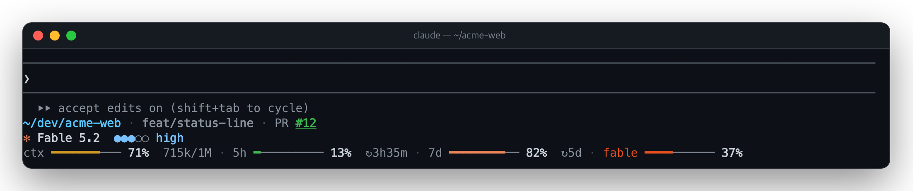

# 📊 status-line

[한국어](README.md) · **English**

A status line under the prompt: which folder and branch you are in, and how much of the context window and the plan's
limits is used, always in view.



## What it shows

```
  ⏵⏵ accept edits on (shift+tab to cycle)            ← Claude Code's own hint line (kept)
  ~/dev/acme-web · feat/status-line · PR #12         ← git row
  ✻ Fable 5.2  ●●●○○ high                            ← model row
  ctx ━━━━━━━─── 71%  715k/1M · 5h ━───────── 13%  ↻3h35m · 7d ━━━━━━━━── 82%  ↻5d · fable ━━━━────── 37%
                                                     ← meter row
```

| Row | Item | What it is |
| --- | --- | --- |
| git | path | The working tree's full path, the home folder as `~`; inside a worktree, that worktree's |
| git | branch | `(commit)` on a detached HEAD; an operation under way (a rebase, a merge, ...) as `(REBASING)` |
| git | pull request | The branch's pull request number; its color is the state, and pressing it opens the page |
| model | model, effort | The model's name and its effort on five steps (`●●●○○ high`) |
| meter | `ctx` | The context window's fill, and `tokens used/window size` |
| meter | `5h`, `7d` | The five-hour and weekly limits, with the time to their reset (`↻3h35m`) |
| meter | `fable` | The Fable-only weekly limit, while the model is Fable |

Outside a repository there is no git row.

### Colors

- **Bars**: by what is left: green, then yellow (half), orange (a quarter), red (a tenth, with a `!`). The `fable`
  meter is always a deep orange, to stand apart from the others.
- **Pull request number**: draft grey; conflict, failed checks or changes requested red; approved and mergeable green;
  any other open one orange; merged purple.

### Fitted to the width

The meters stack under the model row, in as few rows as the width allows and, among those, the widest drawing.

| Width | Meters |
| --- | --- |
| Wide | one row, long bars with their detail (tokens, time left) |
| Narrower | one row with shorter bars, then without the detail |
| Narrow | two rows |
| Very narrow | a row per meter |

The git row cuts the branch name, then the start of the path (`…/acme-web`), and drops the pull request last. Hangul
counts two cells.

A surface that does not say its width is taken as narrow (40 columns on mobile), and the rows ask for a monospaced
face so the bars line up.

## Install

```
/plugin install status-line --marketplace speardragon/ray-claude-code-mods
```

There is no command: once installed it shows in every interactive session.

### Replacing an existing statusLine

A `statusLine` in `~/.claude/settings.json` (claude-hud, say) is drawn apart from this mod. To replace it, remove that
entry; left in, both are drawn. If Claude Code's own pull request footer repeats the number, turn off the PR status
footer in `/config`.

## Options

| Option | Default | What it does |
| --- | --- | --- |
| `githubAccount` | empty | The `gh` account the pull request is looked up as. Where several accounts are logged in and the active one drifts, this pins the call to that account's token (`gh auth token --user`). Empty uses gh's active account, or `GH_TOKEN`. |

## When each value is read again

| Value | When |
| --- | --- |
| Context, five-hour and weekly limits | on every measurement the engine takes, and each minute (the countdowns) |
| Effort | on each request of the main thread, and right after `/effort` or `/model`; guessed from settings before the first |
| Fable limit | once in five minutes, while the model is Fable |
| Git | when a tool that changes files ends (Bash, Edit, Write, ...), and every 30 seconds |
| Pull request | at once when the branch changes, after `git push` or a `gh pr` command, or after a push or pull from another terminal; otherwise every 3 minutes |

Without `gh`, or logged out, only the pull request is left out, and it is asked about less and less often (from 5
minutes up to an hour).

## How the Fable limit is read

The engine hands a mod the five-hour and weekly windows but no per-model one. So the mod calls the usage endpoint the
`/usage` screen reads (`api.anthropic.com/api/oauth/usage`) with the session's login and takes the weekly row scoped
to Fable from `limits`.

- The token never passes through the mod's code: the engine attaches it to the request from a handle, to that host only.
- The API is unofficial and may change. With no Fable row, or an answer of another shape, no meter is drawn; nothing is
  made up.
- A failure (a 401 from an expired login, say) is tried again after 5 minutes, backing off up to an hour.
- A session on an API key or a gateway never calls it.

## Not shown

- Counts of changed files and the distance from upstream: left out to keep the row short.
- Subagents and the task list: Claude Code shows those itself.
