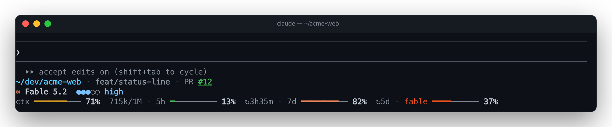

# 📊 status-line

**한국어** · [English](README.en.md)

프롬프트 아래에 상태 줄을 그립니다. 어느 폴더의 어느 브랜치인지, 컨텍스트와 플랜 한도를 얼마나 썼는지가 항상 보여요.



## 보여주는 것

```
  ⏵⏵ accept edits on (shift+tab to cycle)            ← Claude Code의 힌트 줄 (그대로)
  ~/dev/acme-web · feat/status-line · PR #12         ← git 줄
  ✻ Fable 5.2  ●●●○○ high                            ← 모델 줄
  ctx ━━━━━━━─── 71%  715k/1M · 5h ━───────── 13%  ↻3h35m · 7d ━━━━━━━━── 82%  ↻5d · fable ━━━━────── 37%
                                                     ← 미터 줄
```

| 줄 | 항목 | 설명 |
| --- | --- | --- |
| git | 경로 | 작업 트리의 전체 경로. 홈 폴더는 `~`. 워크트리 안에서는 그 워크트리의 경로 |
| git | 브랜치 | HEAD가 떨어지면 `(커밋)`, 리베이스 · 병합 등 진행 중이면 `(REBASING)`처럼 표시 |
| git | PR | 브랜치의 PR 번호. 색이 상태이고, 누르면 브라우저에서 열림 |
| 모델 | 모델 · effort | 모델 이름과 effort 5단계(`●●●○○ high`) |
| 미터 | `ctx` | 컨텍스트 사용률과 `쓴 토큰/창 크기` |
| 미터 | `5h` · `7d` | 5시간 · 주간 한도 사용률과 초기화까지 남은 시간(`↻3h35m`) |
| 미터 | `fable` | Fable 전용 주간 한도. 모델이 Fable일 때만 |

저장소 밖에서는 git 줄이 없어요.

### 색

- **바**: 남은 양에 따라 초록 → 노랑(50% 이하) → 주황(25% 이하) → 빨강(10% 이하, `!` 붙음). `fable` 미터는 다른
  미터와 구분되게 항상 진한 주황입니다.
- **PR 번호**: draft 회색 · 충돌이나 CI 실패나 변경 요청은 빨강 · 승인되고 머지 가능하면 초록 · 그 밖의 열린 PR은
  주황 · 병합됨 보라.

### 폭에 맞는 배치

모델 줄 아래에 미터가 쌓입니다. 미터는 폭이 허락하는 가장 적은 줄 수로, 그 안에서 가장 넓게 그려요.

| 폭 | 미터 |
| --- | --- |
| 넓음 | 한 줄에 긴 바와 상세(토큰 · 남은 시간) |
| 조금 좁음 | 한 줄에 짧은 바, 그다음엔 상세를 뺌 |
| 좁음 | 두 줄 |
| 아주 좁음 | 미터마다 한 줄 |

git 줄은 브랜치 이름, 경로 앞부분(`…/acme-web`) 순으로 줄이고 마지막에 PR을 뺍니다. 한글은 2칸으로 계산해요.

폭을 알려 주지 않는 화면은 좁다고 보고 그리며(모바일 40칸), 바가 어긋나지 않게 고정폭 글꼴을 요청합니다.

## 설치

```
/plugin install status-line --marketplace speardragon/ray-claude-code-mods
```

명령은 없어요. 설치하면 대화형 세션에서 바로 보입니다.

### 기존 statusLine을 대체할 때

`~/.claude/settings.json`의 `statusLine`(예: claude-hud)은 이 mod와 따로 그려집니다. 이 mod로 바꾸려면 그 항목을
지우세요. 남겨 두면 둘 다 보입니다. Claude Code 자체의 PR 표시와 겹치면 `/config`에서 PR status footer를 끄면 됩니다.

## 설정

| 옵션 | 기본값 | 설명 |
| --- | --- | --- |
| `githubAccount` | 비어 있음 | PR을 조회할 `gh` 계정. 계정이 여러 개 로그인돼 있어 활성 계정이 바뀌는 경우, 여기 적은 계정의 토큰(`gh auth token --user`)으로 고정합니다. 비워 두면 `gh`의 활성 계정이나 `GH_TOKEN`을 씁니다. |

## 값을 다시 읽는 때

| 값 | 언제 |
| --- | --- |
| 컨텍스트 · 5시간 · 주간 한도 | 엔진이 새로 잴 때마다, 그리고 1분마다(카운트다운) |
| effort | 메인 스레드의 요청마다, `/effort` · `/model` 직후. 첫 요청 전에는 설정에서 짐작 |
| Fable 한도 | 모델이 Fable인 동안 5분에 한 번 |
| git | 파일을 바꾸는 도구(Bash, Edit, Write 등)가 끝날 때마다, 그리고 30초마다 |
| PR | 브랜치가 바뀌거나 `git push` · `gh pr` 명령 뒤, 다른 터미널에서 push · pull한 뒤 곧바로. 그 밖에는 3분마다 |

`gh`가 없거나 로그인 전이면 PR만 빠지고, 다시 묻는 간격을 늘려 갑니다(5분부터 최대 1시간).

## Fable 한도를 읽는 방법

엔진은 5시간 · 주간 한도만 mod에 주고 모델별 한도는 주지 않아요. 그래서 `/usage` 화면이 쓰는 사용량 엔드포인트
(`api.anthropic.com/api/oauth/usage`)를 세션의 로그인으로 호출해 `limits`에서 Fable 주간 항목을 읽습니다.

- 토큰은 mod 코드를 거치지 않습니다. 엔진이 핸들로 요청에 붙여 주고, 그 주소로만 보냅니다.
- 비공식 API라 형식이 바뀔 수 있어요. Fable 항목이 없거나 응답 모양이 다르면 미터를 그리지 않습니다. 값을 지어내지
  않아요.
- 로그인 만료(401) 등으로 실패하면 5분부터 최대 1시간까지 간격을 늘려 다시 시도합니다.
- API 키나 게이트웨이로 쓰는 세션에서는 호출하지 않습니다.

## 보여주지 않는 것

- 변경된 파일 수와 upstream과의 차이: 줄을 짧게 두려고 뺐어요.
- 서브에이전트와 할 일 목록: Claude Code가 직접 보여줍니다.
