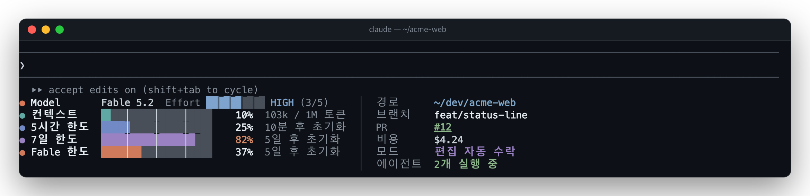

# 📊 status-line

**한국어** · [English](README.en.md)

프롬프트 아래에 상태 줄을 그립니다. 왼쪽에는 모델과 컨텍스트 · 플랜 한도 미터를, 오른쪽에는 경로 · 브랜치 · PR ·
비용 · 권한 모드 · 일하는 에이전트를 표처럼 나란히 보여줘요.



## 보여주는 것

```
  ⏵⏵ accept edits on (shift+tab to cycle)    ← Claude Code의 힌트 줄 (그대로, 맨 위)
● Model       Fable 5.2  Effort ██▎█▎█▎█▎█ HIGH (3/5)     │  경로      ~/dev/acme-web
● 컨텍스트    █▋██│████│████│████    10%  103k / 1M 토큰  │  브랜치    feat/status-line
● 5시간 한도  ████│████│████│████    25%  10분 후 초기화  │  PR        #12
● 7일 한도    ████│████│████│█▏██    82%  5일 후 초기화   │  비용      $4.24
● Fable 한도  ████│█▉██│████│████    37%  5일 후 초기화   │  모드      편집 자동 수락
                                                          │  에이전트  2개 실행 중
```

왼쪽은 미터, 오른쪽은 지금 상태입니다.

| 쪽 | 항목 | 설명 |
| --- | --- | --- |
| 왼쪽 | Model · Effort | 모델 이름과 effort 5단계(`██▎█▎█▎█▎█ HIGH (3/5)`, 정사각형 다섯 칸) |
| 왼쪽 | 컨텍스트 | 컨텍스트 사용률과 `쓴 토큰 / 창 크기` |
| 왼쪽 | 5시간 한도 · 7일 한도 | 사용률과 초기화까지 남은 시간(`2시간 13분 후 초기화`) |
| 왼쪽 | Fable 한도 | Fable 전용 주간 한도와 초기화까지 남은 시간. 지금 모델과 상관없이 항상 |
| 오른쪽 | 경로 | 작업 트리의 전체 경로. 홈 폴더는 `~`. 워크트리 안에서는 그 워크트리의 경로 |
| 오른쪽 | 브랜치 | HEAD가 떨어지면 `(커밋)`, 리베이스 · 병합 등 진행 중이면 `(REBASING)`처럼 표시 |
| 오른쪽 | PR | 브랜치의 PR 번호. 색이 상태이고, 누르면 브라우저에서 열림 |
| 오른쪽 | 비용 | 이 세션에서 쓴 금액(`/cost`와 같은 값) |
| 오른쪽 | 모드 | 권한 모드: 편집 자동 수락 · 플랜 · 자동 · 권한 우회. 기본 모드에서는 줄이 없음 |
| 오른쪽 | 에이전트 | 일하는 중인 서브에이전트 · 팀원 수(대기 · 실행 · 권한 대기). 없으면 `쉬는 중` |

저장소 밖에서는 경로 · 브랜치 · PR이 빠지고, 값이 없는 줄(PR 없음, 비용 장부가 없는 호스트)도 빠집니다. Claude
Code의 힌트 줄은 엔진이 항상 맨 위에 그려서, 이 mod의 줄은 그 아래에 놓입니다.

### 색

- **바**: 미터마다 제 색(컨텍스트 청록, 5시간 파랑, 7일 보라, Fable 테라코타). 형광빛을 뺀 차분한 중간 톤. 빈 칸은 어두운 블록이라 거의
  비어도 바 길이가 그대로 보여요. 칸은 8분의 1 단위로 채워지고, 4묶음 사이에는 밝은 세로선이 들어가
  바를 끊지 않고 나눕니다. effort 사각형 사이는 사각형 색을 어둡게 한 홈입니다.
- **퍼센트**: 남은 양에 따라 기본색 → 노랑(50% 이하) → 주황(25% 이하) → 빨강(10% 이하, 앞에 `!`).
- **PR 번호**: draft 회색 · 충돌이나 CI 실패나 변경 요청은 빨강 · 승인되고 머지 가능하면 초록 · 그 밖의 열린 PR은
  주황 · 병합됨 보라.

### 폭에 맞는 배치

| 폭 | 오른쪽 정보 | 왼쪽 미터 |
| --- | --- | --- |
| 넓음 | 미터 옆에 `│`로 나란히 | 칸 4개짜리 바 4묶음과 설명 |
| 조금 좁음 | 〃 | 바를 3칸 · 2칸 묶음으로 줄임 |
| 좁음 | 미터 아래로 내려가 두 줄로: `경로 · 브랜치 · PR #12`, `비용 · 모드 · 에이전트` | 설명을 지키고 바를 줄임 |
| 아주 좁음 | 〃 | 설명을 빼고, 라벨을 줄이고(`5시간`), 모델 줄은 라벨 없이 |

오른쪽 정보는 미터의 설명(남은 시간 · 토큰 수)을 지킬 수 있을 때만 옆에 붙습니다. 아래로 내려간 git 줄이 넘치면
브랜치 이름, 경로 앞부분(`…/acme-web`) 순으로 줄이고 마지막에 PR을 뺍니다. 한글은 2칸으로 계산해요.

폭을 알려 주지 않는 화면은 좁다고 보고 그리며(모바일 40칸), 바가 어긋나지 않게 고정폭 글꼴을 요청합니다.

## 설치

```
/plugin install status-line --marketplace speardragon/ray-claude-code-mods
```

명령은 없어요. 설치하면 대화형 세션에서 바로 보입니다.

### 기존 statusLine을 대체할 때

`~/.claude/settings.json`의 `statusLine`(예: claude-hud)은 이 mod와 따로 그려집니다. 이 mod로 바꾸려면 그 항목을
지우세요. 남겨 두면 둘 다 보입니다. Claude Code 자체의 PR 표시와 겹치면 `/config`에서 PR status footer를 끄면 됩니다.

## 설정

| 옵션 | 기본값 | 설명 |
| --- | --- | --- |
| `githubAccount` | 비어 있음 | PR을 조회할 `gh` 계정. 계정이 여러 개 로그인돼 있어 활성 계정이 바뀌는 경우, 여기 적은 계정의 토큰(`gh auth token --user`)으로 고정합니다. 비워 두면 `gh`의 활성 계정이나 `GH_TOKEN`을 씁니다. |

## 값을 다시 읽는 때

| 값 | 언제 |
| --- | --- |
| 컨텍스트 · 5시간 · 주간 한도 | 엔진이 새로 잴 때마다, 그리고 1분마다(카운트다운) |
| effort | 메인 스레드의 요청마다, `/effort` · `/model` 직후. 첫 요청 전에는 설정에서 짐작 |
| Fable 한도 | 5분에 한 번(모델과 상관없이) |
| 비용 | 컨텍스트와 같이 |
| 모드 | 힌트 줄이 다시 그려질 때마다(엔진이 모드를 읽는 API를 주지 않아 힌트 줄 글자에서 읽음) |
| 에이전트 | 에이전트가 시작될 때, Agent 도구가 끝날 때, 그리고 5초마다(백그라운드 에이전트의 끝을 알리는 이벤트가 없음) |
| git | 파일을 바꾸는 도구(Bash, Edit, Write 등)가 끝날 때마다, 그리고 30초마다 |
| PR | 브랜치가 바뀌거나 `git push` · `gh pr` 명령 뒤, 다른 터미널에서 push · pull한 뒤 곧바로. 그 밖에는 3분마다 |

`gh`가 없거나 로그인 전이면 PR만 빠지고, 다시 묻는 간격을 늘려 갑니다(5분부터 최대 1시간).

## Fable 한도를 읽는 방법

엔진은 5시간 · 주간 한도만 mod에 주고 모델별 한도는 주지 않아요. 그래서 `/usage` 화면이 쓰는 사용량 엔드포인트
(`api.anthropic.com/api/oauth/usage`)를 세션의 로그인으로 호출해 `limits`에서 Fable 주간 항목을 읽습니다.

- 토큰은 mod 코드를 거치지 않습니다. 엔진이 핸들로 요청에 붙여 주고, 그 주소로만 보냅니다.
- 비공식 API라 형식이 바뀔 수 있어요. Fable 항목이 없거나 응답 모양이 다르면 미터를 그리지 않습니다. 값을 지어내지
  않아요.
- 로그인 만료(401) 등으로 실패하면 5분부터 최대 1시간까지 간격을 늘려 다시 시도합니다.
- API 키나 게이트웨이로 쓰는 세션에서는 호출하지 않습니다.

## 보여주지 않는 것

- 변경된 파일 수와 upstream과의 차이: 줄을 짧게 두려고 뺐어요.
- 할 일 목록: Claude Code가 직접 보여줍니다.
- 출력 스타일: 엔진이 mod에 바로 읽을 방법을 주지 않아요.
