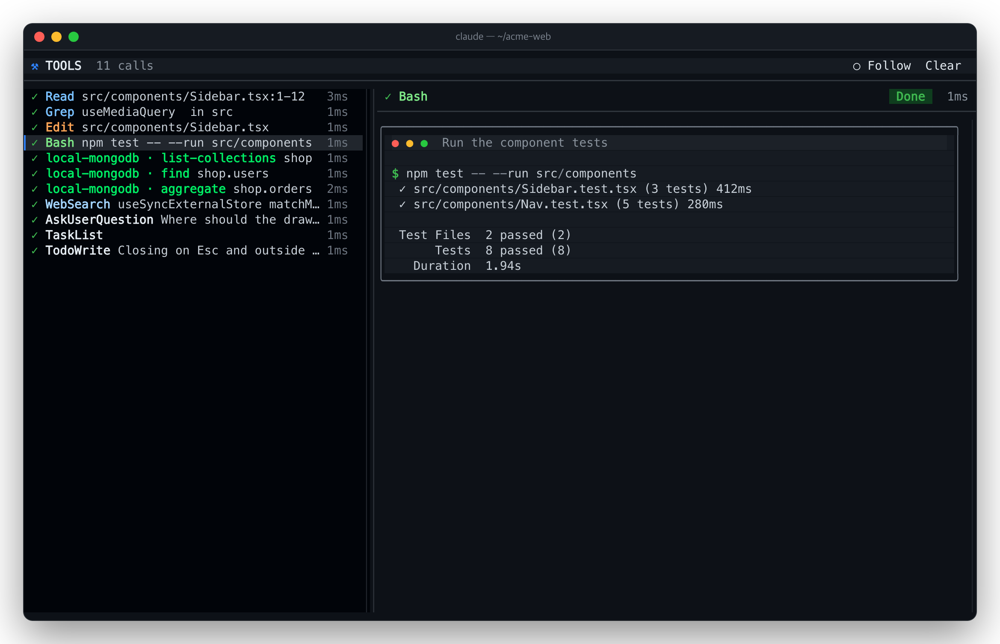
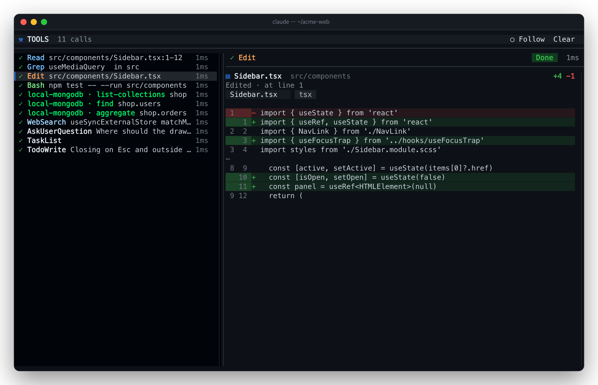
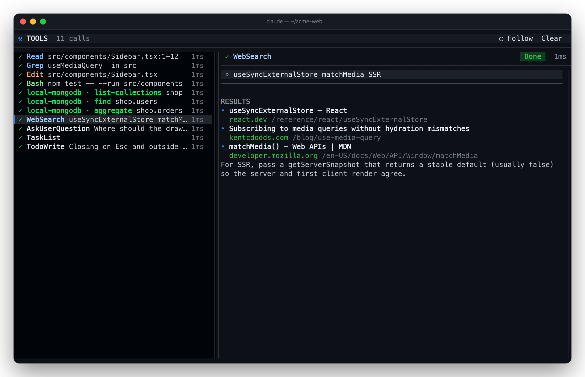
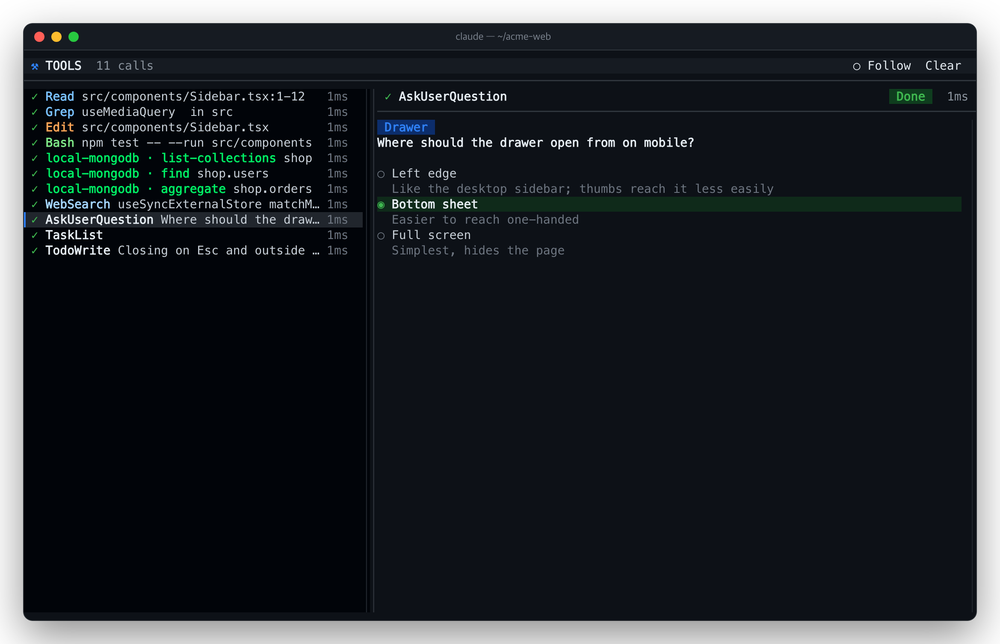

# 🗜️ tool-fold

**한국어** · [English](README.en.md)

Claude가 실행하는 도구 호출을 **한 줄씩** 보여주고 결과 블록은 접어 둡니다. 무엇을 실행했는지, 무엇에 대해, 어떻게 끝났는지
한 줄에 다 나와서 트랜스크립트가 짧아지고, 궁금한 호출은 **클릭해서 펼쳐** 원래 결과를 볼 수 있어요.


## 한 줄에 담기는 것

```
▸ ● Bash      npm test -- --run src/components                5 lines
  │  │         │                                                 └ 어떻게 끝났나
  │  │         └ 무엇에 대해 (명령, 파일 경로는 프로젝트 기준 상대 경로)
  │  └ 도구 (종류별 색, 열 맞춤)
  └ 상태: ● 완료 · ● 에러(빨강) · ◐ 실행 중 · ○ 중단
```

| 도구 | 오른쪽에 나오는 것 |
| --- | --- |
| `Bash` | 출력 줄 수, `stderr` 줄 수, `background`, `timed out` |
| `Read` | 읽은 줄 수 (`20 of 400 lines`) |
| `Edit` · `Write` | `+추가 −삭제`, 새 파일이면 `new · N lines` |
| `WebFetch` | 응답 코드 · 크기 |
| 에러 | 에러 메시지 첫 줄 (빨강) |

## 패널 모드

**`/tools panel`**로 채팅 옆에 도구 패널을 켜고 끕니다. 왼쪽은 이번 세션의 도구 호출 목록(상태 · 도구 · 대상 · 걸린 시간,
새 호출을 자동으로 따라감), 오른쪽은 고른 호출을 **그 도구에 어울리는 화면**으로 보여줘요.


| 도구 | 상세 화면 |
| --- | --- |
| **MongoDB MCP** | Compass 스타일: `server › db › collection`, read/write/admin 배지, Filter · Project · Sort · Limit 쿼리 바, 파이프라인 단계 목록, `1 – N of TOTAL`, 문서 카드(ObjectId 주황 · 문자열 초록 · 숫자/날짜 파랑 · 불리언 분홍), 수정 · 삭제 · 추가 통계, 컬렉션 · 인덱스 목록 |
| Bash | 터미널 창: 신호등 점과 설명 제목, `$ 명령`(강조), 출력, stderr는 빨강 |
| Read | 파일 헤더, "Read lines 10–60 of 400", 파일 안 위치 미니맵, 줄 번호와 구문 강조, 읽은 줄 강조. **이미지는 그림 그대로**(아래 참고) |
| Write · Edit | 편집기 탭과 언어 배지, `+추가 −삭제`, GitHub 다크 diff (새 파일은 줄 번호 붙은 내용) |
| Grep · Glob | 검색창과 결과 수, path/glob 태그, 일치 줄(패턴 강조) |
| WebFetch · WebSearch | 주소창과 상태 코드, 프롬프트, 결과 본문 |
| Agent | 서브에이전트 카드(설명 · 유형 · 프롬프트) 와 결과 |
| TodoWrite · TaskList · TaskCreate · TaskUpdate | 진행 막대와 작업 보드(상태 · 담당 · 막힌 작업), 상태 변화 `○ → ◐` |
| Skill | 스킬 배지, 인자, 허용 도구 |
| AskUserQuestion | 질문과 선택지, 고른 답 강조(직접 입력한 답 포함) |
| ExitPlanMode · EnterPlanMode | 계획 문서(제목 · 체크리스트 · 코드), 수정 여부 |
| ToolSearch | 검색어와 불러온 도구 목록(MCP 서버별) |
| LSP | 작업 종류와 위치 목록(`파일:줄:칸`) |
| Monitor · ScheduleWakeup · Cron | 시계 카드: 다음 실행 시각, 반복 여부, 프롬프트 |
| SendMessage · PushNotification | 받는 대상과 메시지 말풍선, 전송 결과 |
| Workflow | 실행 카드: 이름 · 상태 · run/task id · 요약 |
| MCP 리소스 · Worktree | 리소스 목록과 내용 / 워크트리 경로와 브랜치 |
| 그 밖의 MCP | `server · MCP`, INPUT 키/값, RESULT(JSON이면 트리, 마크다운이면 문서) |

<table><tr>
<td></td>
<td></td>
</tr><tr>
<td></td>
<td></td>
</tr></table>

- 목록 클릭이나 `↑` `↓`로 고르고, 휠 · 스크롤바로 상세를 내려 봐요. 툴바의 `Follow`를 켜 두면 새 호출을 계속 따라가요.
- 패널이 열려 있을 때 트랜스크립트의 한 줄을 클릭하면, 그 자리에서 펼치지 않고 패널에서 그 호출을 보여줘요.
- 성능: 큰 결과는 잘라서 메모리에만 두고(상태에는 가벼운 목록만), 상세 화면은 한 번 그린 걸 재사용하며, 보이는 범위만 그립니다.

### 이미지 미리보기

이미지를 Read한 호출은 상세 화면에 **그림 자체**를 그려요(파일명 · 형식 · 크기 · 용량 헤더 아래, 패널 폭에 맞춰 비율 유지).
트랜스크립트의 한 줄 요약도 `image · 2338×1506 · 324 KB`처럼 보여요.

- PNG는 원본 파일을 바로, JPEG · GIF · WebP는 macOS `sips`(없으면 ImageMagick)로 만든 PNG 사본(`$TMPDIR/tool-fold/`)을 그립니다.
  이미지 바이트는 메모리에 담지 않아요.
- 그림은 kitty · Ghostty · iTerm2 3.5+ 터미널 패널에서 그려져요. 엔진이 모르는 터미널(예: herdr 같은 멀티플렉서 안)에서는
  `~/.claude/settings.json`의 `env`에 `"CLAUDE_CODE_FORCE_TERMINAL_IMAGES": "1"`을 넣고 재시작하세요.
  herdr는 `config.toml`의 `[experimental] kitty_graphics = true`도 필요해요.
- 그릴 수 없을 때는 대신: 그림 자리에 `▣ 파일명 · 형식 · 크기` · 데스크톱에서는 안내 문구 · 변환에 실패하면 그 이유.

## 펼치기

- **줄을 클릭**하면 `▸`가 `▾`로 바뀌고 그 아래에 엔진의 원래 결과 블록이 나타나요. 다시 클릭하면 접힙니다.
- 마우스를 올리면 줄 배경이 은은하게 바뀌어요.
- `/tools expand`로 전부 펼치고 `/tools collapse`로 전부 접을 수 있어요.
- verbose 모드(`"verbose": true`)와 `ctrl+o`(전체 트랜스크립트)에서도 접혀요. 그 두 곳은 엔진에 맡기고 싶다면 설정의
  `yieldExpanded`를 켜세요.

## 설치

```
/plugin install tool-fold --marketplace speardragon/ray-claude-code-mods
```

## 사용법

| 입력 | 동작 |
| --- | --- |
| `/tools` | 켜기 / 끄기 (토글, 다음 세션에도 유지) |
| `/tools on` · `/tools off` | 켜기 · 끄기 |
| `/tools panel` | 도구 패널 켜기 / 끄기 (`/tools panel on` · `off`) |
| `/tools expand` · `/tools collapse` | 모든 호출 펼치기 · 접기 |
| `/tools stats` | 이번 세션에 도구 줄을 몇 번 접어 그렸는지, 엔진에 넘겼다면 이유 |
| 줄 클릭 | 그 호출만 펼치기 / 접기 |

## 설정

| 키 | 기본값 | 설명 |
| --- | --- | --- |
| `yieldExpanded` | `false` | 엔진이 전체를 보여주는 곳(`ctrl+o`, verbose 모드)에서는 엔진 방식대로 그리기 |

## 알아두면 좋은 것

- 클릭은 전체 화면 레이아웃의 터미널에서 동작해요. 그 밖에서는 `/tools expand`와 `ctrl+o`를 쓰세요.
- 2000px가 넘는 이미지는 Read가 줄여 JPEG로 모델에 보내지만, 패널은 원본 파일을 그려요.
- "Read 3 files"처럼 엔진이 한 줄로 묶어 보여주는 읽기·검색 묶음은 이미 한 줄이라 그대로 둡니다.
- [Tickloop/claude-mods](https://github.com/Tickloop/claude-mods)의 `tool-lines`에서 출발해, 다시 펼칠 수 있게 하고 결과 요약을 더했어요.
